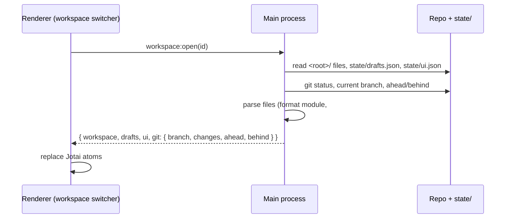
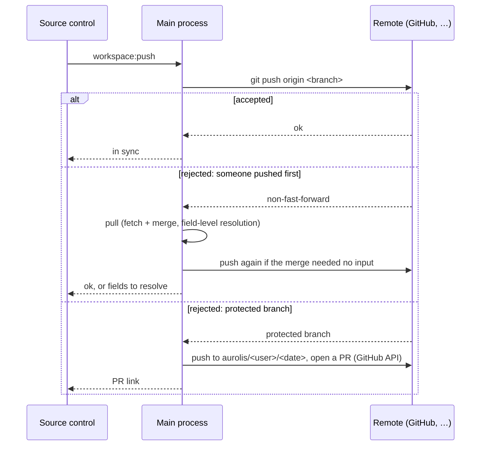

# Workspace architecture

**Status:** Accepted (revised: workspaces are local git clones) · **Issue:** #3 · **Builds on:** #1 (GitHub sign-in)

This document is the single reference for how Aurolis stores workspaces, links them to git remotes, switches between them and syncs them. Later issues implement parts of it; the [issue map](#issue-map) at the end shows which.

- [Summary](#summary)
- [Terms](#terms)
- [Workspaces and repositories](#workspaces-and-repositories)
- [Storage folder](#storage-folder)
- [On-disk layout](#on-disk-layout)
- [Git engine](#git-engine)
- [Platform support](#platform-support)
- [What goes into git](#what-goes-into-git)
- [Secrets](#secrets)
- [Switching workspaces](#switching-workspaces)
- [Lifecycle flows](#lifecycle-flows)
- [Why local git clones](#why-local-git-clones)
- [Security rules](#security-rules)
- [Limits](#limits)
- [Out of scope](#out-of-scope)
- [Issue map](#issue-map)

---

## Summary

- **A workspace is a git repository on the user's machine**, with its own `.git` folder: a clone of a remote, a repo the user already had, or a new local repo. Aurolis reads the workspace from a folder inside it (`aurolis.json` marks that folder).
- **Sync is plain git:** `git status` for changes, `git diff` / `git show` for diffs, `git commit` locally (works offline), `git fetch` + `git merge` to pull, `git push` to publish. It works with GitHub, GitLab, Bitbucket or any git host, like VS Code's Source Control.
- **The user chooses where workspaces are stored**, once, right after signing in or choosing "Continue on this device". The default is an `Aurolis` folder in their home folder, and each workspace is a normal, visible folder inside it.
- Aurolis uses the **git already installed** on the computer (2.31 or newer). It doesn't bundle git: without a usable one, it asks the user to install it. It runs on macOS, Windows and Linux; per-OS differences are listed in [Platform support](#platform-support).
- All git commands, files and tokens are handled in the **Electron main process**. The renderer asks for data by workspace id over IPC and never sees paths or tokens.
- Per-user data (drafts, UI state, history, secrets) lives **outside the repo**, so it can never be committed.
- The GitHub REST API (`electron/github-sync.ts`) is used only for things git can't do: listing the user's repositories and permissions, creating a repository to publish to, the GitHub App install page, and opening pull requests.

## Terms

| Term | Meaning |
|---|---|
| **Workspace** | A set of collections and environments. The unit you switch between. Backed by one git repository on disk. |
| **Repository (repo)** | The git repository on disk, with its `.git` folder. |
| **Workspace root** | The folder inside the repo that contains `aurolis.json`. Usually the repo root; a subfolder for monorepos. |
| **Remote** | The repo's `origin` on a git host. A workspace without a remote is local-only. |
| **Working tree** | The saved files on disk. What Ctrl/⌘ S writes to and what `git status` compares. |
| **Draft** | An unsaved edit. Lives in the workspace's state folder, never in the repo. |
| **Branch** | The repo's checked-out branch. Switching branches is a git operation inside a workspace, not a different workspace. |

## Workspaces and repositories

### The rules

1. **One workspace = one repository + a workspace root inside it.** The root is where `aurolis.json` lives (`""` = the repo root, or e.g. `workspaces/payments` in a monorepo).
2. **Three ways to get a repository:**
   - **Clone** a remote (picked from the user's GitHub repos, or any HTTPS git URL) into the [storage folder](#storage-folder).
   - **Open an existing folder** the user already cloned, e.g. `~/code/payments-api`. Aurolis uses it in place.
   - **Create a local workspace:** Aurolis runs `git init` in a new folder in the storage folder. It has history from the first commit and can be published later.
3. **Different workspaces can use different repos and hosts** at the same time: a personal one on GitHub, a team one on GitLab, a local-only one.
4. **One repo can back several workspaces** when their workspace roots differ (monorepo subfolders).
5. **The same repo folder + workspace root can't be added twice.** Adding a remote that is already cloned (same remote URL + root) opens the existing workspace instead of cloning again.
6. **The branch belongs to the repo, not the workspace.** Switching branches checks out another branch in the same folder, like VS Code. To work on two branches side by side, clone the repo twice (each clone is its own workspace).
7. **Removing a workspace never deletes a folder the user brought** (rule 2, second case). For folders Aurolis created (`managed: true`), the user chooses between "Remove from Aurolis" (keep the folder) and "Delete folder too" (after a warning about unpushed commits).

### Examples

| Workspace | Repository folder | Workspace root | Remote |
|---|---|---|---|
| My workspace | `~/Aurolis/my-workspace` | `/` | — (local) |
| Payments API | `~/Aurolis/payments-api` | `/` | `github.com/acme/payments-api` |
| Identity | `~/code/platform` (user's own clone) | `workspaces/identity` | `github.com/acme/platform` |
| Partner API | `~/Aurolis/partner-api` | `/` | `gitlab.com/acme/partner-api` |

### What's inside the workspace root

The workspace root has the layout described in [github-integration.md › Repository structure](./github-integration.md#repository-structure): `aurolis.json`, one `*.req.json` file per request under `collections/`, one `*.env.json` per environment under `environments/`. The file format and its schemas are owned by #4 (`src/lib/workspace-format.ts`). Other files in the repo (README, source code, CI) are left alone.

## Storage folder

Workspaces are ordinary folders the user can see, back up and open in other tools, so the user decides where they live.

### When it's asked

Once, on first run, **right after signing in with GitHub or choosing "Continue on this device"**, before the first workspace is created. The step shows the default, a "Choose another folder…" button (the OS folder picker), and the free space on that drive. It can be changed later in **Settings → Storage**.

### Default

| OS | Default storage folder |
|---|---|
| macOS | `~/Aurolis` (`/Users/<you>/Aurolis`) |
| Windows | `%USERPROFILE%\Aurolis` (`C:\Users\<you>\Aurolis`) |
| Linux | `~/Aurolis` (`/home/<you>/Aurolis`) |

The default is the home folder, **not Documents**: macOS often syncs Documents to iCloud Drive, and Windows often backs Documents up to OneDrive, and file-sync services corrupt `.git` folders.

### Checks on the chosen folder

| Check | Result |
|---|---|
| Can be created and written to | Required |
| Inside a cloud-synced folder (iCloud Drive, OneDrive, Dropbox, Google Drive) | Warning explaining the `.git` risk; the user can still continue |
| On a network drive | Warning: git is slow and file watching is unreliable there |
| Inside an existing git repository | Warning: workspaces would be nested inside another repo |
| Inside Aurolis's app data folder | Refused: that folder is removed when the app is uninstalled on some systems |

### How folders are named

Each new workspace gets `<storage folder>/<workspace-name-slug>`, e.g. `~/Aurolis/payments-api`, with `-2`, `-3` if the name is taken. Renaming a workspace in Aurolis doesn't rename its folder. When cloning, "Clone into…" can override the folder for that one workspace.

### Changing it later

Changing the storage folder in Settings only affects **new** workspaces. Existing ones keep working where they are, because the registry stores each workspace's absolute folder. Moving existing workspaces is out of scope for now (git repositories can be moved, but the user can do that and re-open them).

## On-disk layout

Aurolis uses two places:

- **The storage folder** (above) holds the workspace repositories: ordinary git folders the user owns.
- **Electron's `userData` folder** holds Aurolis's own data: the registry, the GitHub session and each workspace's per-user state. It's never inside a repository.

| OS | `userData` |
|---|---|
| macOS | `~/Library/Application Support/Aurolis` |
| Windows | `%APPDATA%\Aurolis` |
| Linux | `~/.config/Aurolis` |

```
~/Aurolis/                           ← storage folder (chosen by the user)
├── payments-api/                    ← a workspace repository
│   ├── .git/
│   └── aurolis.json, collections/, environments/, …
└── my-workspace/
    ├── .git/
    └── aurolis.json, collections/, environments/

<userData>/
├── github-token.bin                 ← GitHub session (electron/github-auth.ts), safeStorage-encrypted
├── workspaces.json                  ← registry: storage folder, all workspaces, activeWorkspaceId
└── workspaces/<workspaceId>/
    └── state/                       ← per-user, never inside a repository
        ├── drafts.json              ← unsaved edits (Ctrl/⌘ S writes them into the working tree)
        ├── ui.json                  ← open tabs, selected environment
        ├── conflicts.json           ← unresolved fields during a merge
        ├── history/  runs/          ← request history, load-test runs
        └── secrets.bin              ← environment secret values, safeStorage-encrypted
```

**Nothing Aurolis-specific is ever written inside a repository** except the workspace files themselves, so the same folder works the same in VS Code, a terminal or CI.

`workspaceId` is a random UUID. It never changes, so renaming a workspace never moves anything on disk.

### `workspaces.json`

```json
{
  "version": 1,
  "storageFolder": "/Users/alex/Aurolis",
  "activeWorkspaceId": "9b1c7c1e-…",
  "workspaces": [
    {
      "id": "9b1c7c1e-…",
      "name": "Payments API",
      "repoDir": "/Users/alex/Aurolis/payments-api",
      "managed": true,
      "root": "",
      "remote": {
        "url": "https://github.com/acme/payments-api.git",
        "github": { "repoId": 812345678, "owner": "acme", "repo": "payments-api", "permissions": { "push": true, "admin": false } }
      },
      "createdAt": "2026-11-24T10:00:00.000Z",
      "lastOpenedAt": "2026-11-24T12:30:00.000Z"
    },
    {
      "id": "3e5a…",
      "name": "Identity",
      "repoDir": "/Users/alex/code/platform",
      "managed": false,
      "root": "workspaces/identity",
      "remote": { "url": "https://github.com/acme/platform.git", "github": null },
      "createdAt": "2026-11-22T09:00:00.000Z",
      "lastOpenedAt": "2026-11-23T18:00:00.000Z"
    }
  ]
}
```

- `storageFolder` is `null` until the first-run step is done; Aurolis creates no workspace before that.
- `repoDir` is always the absolute path of the repository. `managed: true` means Aurolis created the folder (clone or new workspace); `managed: false` means the user brought it, and Aurolis never deletes it.
- A workspace whose `repoDir` no longer exists (moved, deleted, external drive unplugged) is shown as **missing** with "Locate folder…" and "Remove from Aurolis".
- `remote` is a cache of `origin`. **git's own config is the source of truth**: the branch, ahead/behind counts and the remote URL are always read from git, never stored here.
- `remote.github` is filled for GitHub remotes. `repoId` keeps the link working if the repo is renamed or transferred, and `permissions` caches the user's role (#16).

### Writing safely

- All file and git operations run in the main process (`electron/workspace-store.ts`, `electron/git.ts`).
- Workspace files are written atomically (write `<file>.tmp`, then rename), through one queue per workspace.
- Git commands for one repo run one at a time (a per-repo queue), so two operations never race on `.git/index.lock`.
- Every path is resolved and checked to stay inside the workspace root before reading or writing.
- The folder is watched for changes made outside Aurolis (another editor, `git checkout` in a terminal) and reloaded.

## Git engine

Implemented in `electron/git.ts` (#21).

- **Which git:** the system git is used when it's installed and at least 2.31 (needed for per-command configuration). Aurolis looks on `PATH` and in the usual install locations (`/opt/homebrew/bin`, `/usr/local/bin`, `Program Files\Git`), because apps opened from Finder don't get the shell's `PATH`. On macOS it first checks `xcode-select -p`, so it never triggers the "install developer tools" prompt from `/usr/bin/git`. Aurolis doesn't bundle git. Without a usable system git, git operations fail with `git_unavailable` and the app asks the user to install Git 2.31 or newer; the search runs again on the next operation, so no restart is needed.
- **Authentication:** for HTTPS remotes on github.com, the GitHub App user token from the device flow (`electron/github-auth.ts`) is the password. It's supplied per command as an `http.https://github.com/.extraheader` setting through git's environment configuration (`GIT_CONFIG_COUNT` / `GIT_CONFIG_KEY_0` / `GIT_CONFIG_VALUE_0`), scoped to github.com and **never written into the remote URL, `.git/config` or a command-line argument**. `GIT_TERMINAL_PROMPT=0` stops git from waiting for input. The token is fetched fresh before each network command, so the 8-hour expiry is handled by the existing refresh.
- **Other hosts and SSH:** if the user's own git credential helper or SSH agent is configured, git uses it as normal. Aurolis doesn't store credentials for other hosts.
- **Commit identity:** the repo's or user's git config (`user.name`, `user.email`) if set; otherwise the GitHub profile name with `<id>+<login>@users.noreply.github.com`. For a local-only workspace with no identity, Aurolis asks once.
- **Settings on repos Aurolis clones or creates:** `core.autocrlf=false` (workspace files are always LF) and `core.longpaths=true` on Windows. Folders the user brought keep their own config.
- **Merge settings, per command only:** workspace files are routed to a merge driver that always reports a conflict when both sides changed them, so Aurolis resolves them field by field (see [Pull](#pull-13)). This is set through `.git/info/attributes` and `-c` flags, never committed, so it doesn't affect anyone else's git.

## Platform support

Aurolis supports **macOS, Windows and Linux**. All OS-specific behaviour lives in the main process (`electron/`), behind `process.platform` checks; the renderer never branches on the OS.

| Area | macOS | Windows | Linux |
|---|---|---|---|
| App data (`userData`) | `~/Library/Application Support/Aurolis` | `%APPDATA%\Aurolis` | `~/.config/Aurolis` |
| Default storage folder | `~/Aurolis` | `%USERPROFILE%\Aurolis` | `~/Aurolis` |
| Git (2.31 or newer, installed by the user) | Xcode Command Line Tools or Homebrew | Git for Windows | The distribution's `git` package |
| Secrets and token encryption | Keychain | DPAPI | libsecret / KWallet; without one, memory only with a warning |
| File watching | Native (FSEvents) | Native (ReadDirectoryChangesW) | inotify; large repos can hit `fs.inotify.max_user_watches`, so Aurolis falls back to polling and says so |
| Path length | No practical limit | `core.longpaths=true` on repos Aurolis manages; Node handles long paths | No practical limit |
| Case sensitivity | Usually case-insensitive | Case-insensitive | Case-sensitive |
| Reserved file names | — | `CON`, `PRN`, `AUX`, `NUL`, `COM1`–`COM9`, `LPT1`–`LPT9` (with any extension) can't be files | — |
| Line endings | LF | LF in workspace files (`core.autocrlf=false` on managed repos) | LF |
| Cloud-synced folders to warn about | iCloud Drive (`~/Library/Mobile Documents`) | OneDrive | Dropbox, Google Drive clients |
| Signing | The app is signed and notarized, or Gatekeeper blocks it | The app is code-signed, or SmartScreen warns | AppImage, no signing |

What this means for the code:

- **File names:** workspace file names are lowercase slugs (#4), so they never clash on case-insensitive disks. Slugs that would be a reserved Windows name get a suffix, so a request named "Con" is still a valid file everywhere (#23).
- **Paths:** always built with `node:path` in the main process and stored as absolute paths; never concatenated by hand or passed from the renderer.
- **Git is a prerequisite:** Aurolis ships no git binaries, so there is nothing extra to build, unpack or sign per OS and architecture. The user's own git install (and its credential helper) is always the one that runs.
- **Folder picker:** the native dialog (`dialog.showOpenDialog`) runs in the main process, so the chosen path never comes from renderer input.

## What goes into git

| Data | Where | In git |
|---|---|---|
| Collections, folders, requests, examples | `<root>/collections/…` | ✅ |
| Environments (non-secret values) | `<root>/environments/*.env.json` | ✅ |
| Workspace marker | `<root>/aurolis.json` | ✅ |
| Environment **secret values** | `state/secrets.bin` | ❌ never |
| Drafts | `state/drafts.json` | ❌ |
| Open tabs, selected environment | `state/ui.json` | ❌ |
| Request history, load-test runs | `state/history/`, `state/runs/` | ❌ |
| GitHub session | `<userData>/github-token.bin` | ❌ |

Only **saved** files can be committed. A draft has to be saved with Ctrl/⌘ S first.

## Secrets

- A variable marked **secret** is written to its `*.env.json` file with the key and an **empty value** (enforced by the format module, #4):
  ```json
  { "enabled": true, "key": "apiKey", "secret": true, "value": "" }
  ```
- The real value is stored in `state/secrets.bin`, keyed by environment id + variable key, encrypted with Electron `safeStorage` (macOS Keychain, Windows DPAPI, libsecret/KWallet on Linux).
- `electron/secret-store.ts` merges the values into the workspace when it's opened, so they can be edited on the Environments screen and used in requests. Saving, duplicating, renaming and deleting an environment keeps `secrets.bin` in step.
- Without a real keychain (Linux `basic_text`), secrets are kept **in memory only** for the session. The Environments screen shows a warning when an environment has secrets.
- Before every commit, Aurolis checks that no secret value (4 characters or longer) appears in a changed file under the workspace root, and refuses to commit if one does, naming the files.

## Switching workspaces



- Drafts and UI state are per workspace and already on disk, so switching needs no "unsaved changes" prompt and never loses work.
- The renderer keeps **one workspace in memory**: the active one.
- Requests in flight keep running; their results go to the history of the workspace they were sent from.
- Background fetching (#17) only runs for the active workspace.
- On launch, Aurolis opens `activeWorkspaceId`. If the registry is empty, it creates a local "My workspace".

## Lifecycle flows

### Choose the storage folder (#5, #7)
Shown once after sign-in or "Continue on this device". Saves `storageFolder` in the registry after the [checks](#checks-on-the-chosen-folder).

### Create a local workspace (#5, #7)
`git init` in `<storage folder>/<name-slug>`, write `aurolis.json`, make the first commit, add the registry entry (`managed: true`) and open it.

### Edit collections (#25)
Creating, renaming, saving and deleting collections, folders, requests and examples all go through one main-process call, `aurolis:collection:apply`, with a typed operation (`src/lib/collection-ops.ts`, validated by `src/validators/collection-ops.schema.ts`). `electron/collection-store.ts` runs it in one queue per workspace:

1. Read the workspace root from disk and parse it with the format module (#4).
2. Apply the operation to the parsed tree. New ids are generated in the main process.
3. Serialize the tree twice, before and after the change, with the parsed paths as `previousPaths`, and write only the files whose content changed (atomically). Files that only differ from the disk because of normalization are left alone.
4. Delete the files that were parsed and are now gone, then remove folders left empty. Renaming an item moves its file (and a request's `.examples/` folder) and changes nothing else.

The store never writes outside `collections/` and `environments/` (plus `aurolis.json` for the workspace description and default environment), never overwrites a file it couldn't parse, and never deletes one. Folders without a `_folder.json` aren't given one unless their settings are saved.

### Save (#25)
Edits to a request are drafts in `drafts.json` until saved. Ctrl/⌘ S saves the active request, Ctrl/⌘ Shift S saves all of them, and "Discard changes" drops the draft. Saving runs the `save-request` operation above, so only that request's file changes. No git command runs. Open tabs and the active tab are kept in `ui.json`. Collection, folder and example settings are saved directly from their tabs.

### Environments (#9, #25)
The Environments screen lists **Globals** first, then the workspace's environments. Creating, renaming, saving, duplicating and deleting an environment, saving globals and choosing the default all go through `aurolis:collection:apply` like collection edits, and only write `environments/` and `aurolis.json`.

- **Use** picks the environment on this device, like the environment menu in the header. The choice is kept in `state/ui.json`, so it isn't committed. **Make default** writes `defaultEnvironment` to `aurolis.json`, so it's committed and picked when the workspace opens.
- A variable can be marked secret with the lock in its row. See [Secrets](#secrets).
- Deleting an environment that is the default clears the default.

### Commit and sync (#25)
"Commit & sync" in the header (with the number of changed files) opens a dialog that asks for a commit message and lists what changed as **items, not files**: requests by name under their collection, plus folders, collection settings, environments, globals and workspace settings, each marked `A`, `M`, `D`, or `R` for renamed and moved items. Deleted items are named from `git show HEAD:<file>`.

- **Commit only:** `git add -- <workspace root>`, the [secret check](#secrets), then `git commit -m <message>`. It works offline.
- **Commit & sync:** the same commit, then `git fetch`, `git merge --no-edit @{upstream}` when the branch has one, then `git push --set-upstream origin <branch>`. A merge that conflicts is aborted, so the working tree is left as it was, and the dialog says what happened.
- **Sync:** offered when there is nothing to commit but local commits haven't been pushed yet.
- Unsaved drafts aren't committed; the dialog says how many there are.

Field-level merging, pushing to a branch with a pull request when the branch is protected, and committing selected items are still to come in #13, #14 and #15.

### See changes (#10)
`git status --porcelain=v2 -- <root>` lists changed files. The format module maps them to API items (request, folder, collection, environment), so a renamed request shows as one moved request. The request-level diff compares `git show HEAD:<file>` with the working file, both parsed by the format module.

### Clone a workspace (#11)
Pick a GitHub repository (with the read-only badge from its permissions) or paste any HTTPS git URL, plus an optional workspace root. If that remote and root are already a workspace, open it. Otherwise `git clone --filter=blob:none` into `<storage folder>/<repo-name>` (or the folder chosen with "Clone into…"). For a subfolder root, a sparse checkout limits the files on disk to that folder. If `aurolis.json` is missing, offer to initialize the root as a workspace.

### Open an existing folder (#11)
Pick a folder. Aurolis checks it is a git repository (`git rev-parse`), finds `aurolis.json` files to choose a root, and registers it with `managed: false`. Nothing in the folder is changed.

### Publish a local workspace (#12)
Offered for any workspace without an `origin` ("Publish to GitHub" on the dashboard and in the workspace switcher). The sheet asks for:

- **Repository name:** prefilled with the workspace name as a slug (`Payments API` → `payments-api`). Letters, numbers, `.`, `-` and `_`.
- **Owner:** the signed-in user, or an organization where the Aurolis GitHub App is installed.
- **New or existing:** create a new repository (private by default, or public), or use an **empty** repository the user already created.
- **Uncommitted changes:** when there are any, a switch (on by default) commits them under the workspace root first.

Then it runs two steps, each shown with its status:

1. **Repository.** New: `POST /user/repos` or `POST /orgs/{org}/repos` (`createRepository` in `electron/github-sync.ts`). Existing: `GET /repos/{owner}/{repo}` must succeed with `push` permission, and `GET …/commits` must report an empty repository (`getEmptyRepository`). Aurolis never publishes to a repository that already has commits, so nothing on GitHub is overwritten.
2. **Push** (`publishWorkspace` in `electron/workspace-store.ts`, `aurolis:workspace:publish`). The renderer sends only the workspace id, owner and repository name; the main process builds `https://github.com/<owner>/<repo>.git` itself, runs `git remote add origin <url>` and `git push --set-upstream origin <branch>`, then stores the remote in the registry. If the push fails, the remote is removed again so the workspace stays local and can be retried.

When a step fails, the sheet explains what to do next instead of a bare error:

| Failure | Offered |
|---|---|
| The repository already exists | Publish to it if it's empty |
| The app isn't allowed to create repositories for that owner | Create it on github.com (prefilled `github.com/new`), then publish to it |
| Aurolis can't see the existing repository, or GitHub refuses the push (an installation on *selected repositories* that doesn't include the new repo) | Open the app's installation page to give access, then try again |
| The repository isn't empty, or the user can't push to it | Go back and choose another |

A repository created in step 1 is remembered for the retry, so "Try again" only repeats the push.

### Commit (#14)
Commit is **local and works offline**: `git add -- <changed files under root>`, run the secret check, then `git commit -m <message>`. When the message is empty, Aurolis writes one (`Update Create payment`, `Update 3 requests`). Selected items can be committed on their own; the rest stay as changes.

### Push (#14)



### Pull (#13)
`git fetch`, then `git merge origin/<branch>`:
- files changed on **one side only** merge normally;
- workspace files changed on **both sides** always stop as a conflict (see [Git engine](#git-engine)). Aurolis reads the three versions with `git show :1:<file>`, `:2:` and `:3:`, merges them **field by field** (method, URL, headers by key, body, auth, examples) and writes the result;
- if the same field changed differently on both sides, it goes to `state/conflicts.json` and the UI asks "Keep mine / Take theirs" per field;
- once every file is resolved and valid, Aurolis runs `git add` and finishes the merge commit.

Other files in the repo (not workspace files) use git's normal merge. If they conflict, Aurolis asks the user to resolve them in their editor.

### Discard (#15)
`git restore --source=HEAD -- <files>` for changed files; delete the file for new ones.

### Switch branch (#15)
`git switch <branch>` (or create one). With uncommitted changes, Aurolis asks to commit or discard first, like VS Code. Drafts are kept per workspace and stay on top of whatever branch is checked out.

### Remove a workspace (#5)
Remove the registry entry and `state/`. For a managed folder, the user picks "Remove from Aurolis" (keep the folder) or "Delete folder too" (after a warning about unpushed commits). A folder the user brought is never deleted. Nothing on the remote is touched.

### Sign out (#7)
The GitHub session is deleted. All workspaces stay and still work locally, including commits. Push and pull to GitHub need the user to sign in again.

## Why local git clones

| | Local git clone (chosen) | GitHub REST API only (earlier design) |
|---|---|---|
| Offline | Commit, history, diff and branch all work offline | Commits need the network |
| Hosts | Any git host (GitHub, GitLab, Bitbucket, self-hosted) | GitHub only |
| Existing clones | Open a repo the user already has | Not possible |
| Other tools | VS Code, terminal git and CI see the same repo | Repo only touched through Aurolis |
| Limits | No API rate limit or per-file API limits | 5 MB per file, 1,000 changes per commit, rate limit |
| Cost | Needs git installed, and must handle edits made outside the app | No git needed, simpler state |

The REST layer from #1 stays for what git can't do: listing repositories and permissions, the install page, and opening pull requests.

## Security rules

- Git, workspace files, secrets and tokens are only touched in the **main process**.
- IPC takes **workspace ids**, never file paths or git arguments. Folders are only ever chosen through the native folder picker, which runs in the main process. The main process builds every git command itself; the renderer can't pass flags or refs that weren't validated.
- Tokens are passed to git through per-command environment configuration, scoped to github.com, never in a URL, a config file, a command-line argument or a log.
- Every resolved path must stay inside the workspace root.
- Secret values never reach the working tree; a pre-commit check blocks them anyway.
- Clone URLs are limited to `https://` (and `ssh://` / `git@` when the user's own SSH setup is used). `file://` and other transports are refused.
- Requests run in the main process (`electron/engines/`). The engines only accept `http(s)://` and `ws(s)://` URLs, validate headers and sizes, and never attach the GitHub token. Response bodies are shown as text, JSON or images, never rendered as HTML.

## Limits

| Limit | What happens |
|---|---|
| Git required | Git 2.31 or newer must be installed; without it, Aurolis shows how to install it and git operations fail until it is. |
| Large repos | Clones use `--filter=blob:none` (and sparse checkout for a subfolder root), so only needed files are downloaded. |
| GitHub file size | GitHub rejects files over 100 MB on push; workspace files are small JSON, so this only affects other files in the repo. |
| Workflow files | Pushing changes to `.github/workflows/` needs the GitHub App's **Workflows** permission; Aurolis never writes there itself. |

## Out of scope

- **Moving existing workspaces** when the storage folder changes (they keep working where they are).
- **Rebase** as the pull strategy (merge only, for now).
- **Staging individual lines** (whole files or whole items only).
- **Sharing secrets through the repo** (encrypted with sops/age, or vault references).
- **More than one GitHub account** signed in at the same time.
- **Storing credentials for other git hosts** (the user's own credential helper or SSH agent is used).
- **Real-time collaboration** (live cursors, presence).

## Issue map

| Section | Issue |
|---|---|
| Foundations | #2 |
| This document | #3 |
| File format in the workspace root | #4 |
| [Storage folder](#storage-folder) (setting, checks, folder naming) | #5 |
| [On-disk layout](#on-disk-layout), registry, [create](#create-a-local-workspace-5-7) and [remove](#remove-a-workspace-5) | #5 |
| [First-run storage step](#choose-the-storage-folder-5-7) | #7 |
| [Switching workspaces](#switching-workspaces) | #6 |
| Local mode, [sign out](#sign-out-7) | #7 |
| [Edit collections](#edit-collections-25), examples, [save](#save-25) and drafts, request engines (HTTP, GraphQL, WebSocket and Socket.IO) | #25 (replaces #8) |
| [Environments](#environments-9-25), [Secrets](#secrets) | #9 |
| [Commit and sync](#commit-and-sync-25) from the header | #25 |
| [See changes](#see-changes-10) | #10 |
| [Clone](#clone-a-workspace-11), [open an existing folder](#open-an-existing-folder-11) | #11 |
| [Publish](#publish-a-local-workspace-12) | #12 |
| [Pull](#pull-13) | #13 |
| [Commit](#commit-14), [push](#push-14) | #14 |
| Source control screen, [discard](#discard-15), [switch branch](#switch-branch-15) | #15 |
| Permissions (`remote.github.permissions`) | #16 |
| Background fetch and status | #17 |
| [Git engine](#git-engine), finding the system git per OS | #21 |
| [Platform support](#platform-support): reserved Windows names | #23 |
