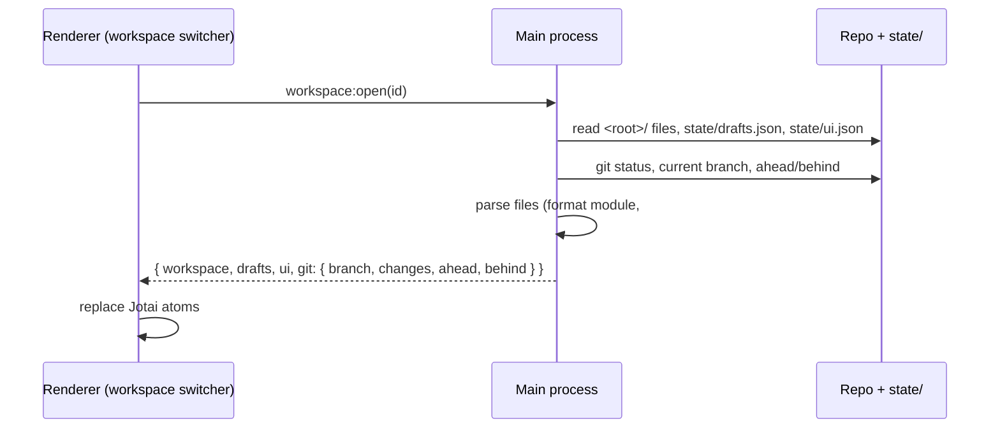
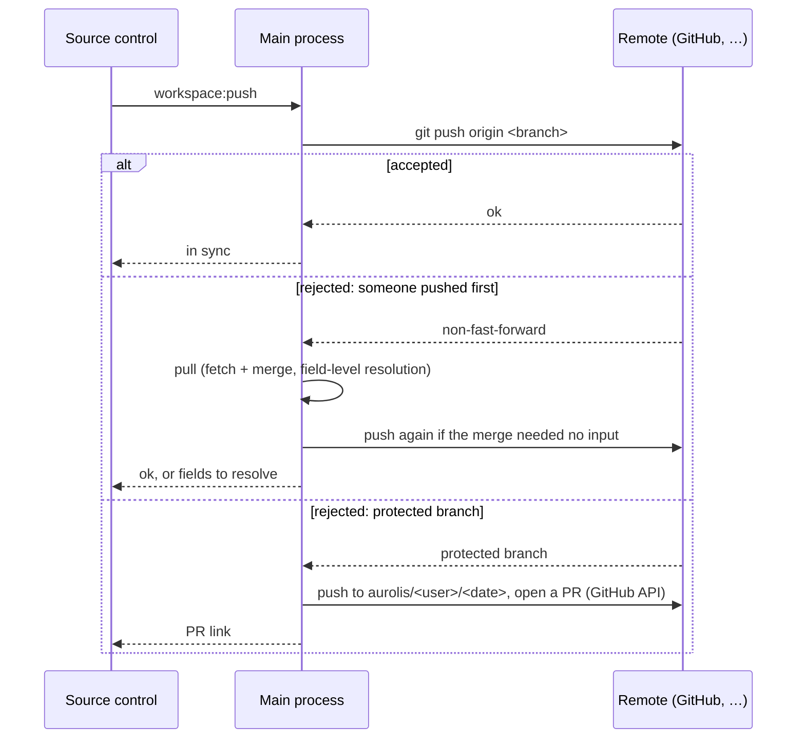

# Workspace architecture

**Status:** Accepted (revised: workspaces are local git clones) · **Issue:** #3 · **Builds on:** #1 (GitHub sign-in)

This document is the single reference for how Aurolis stores workspaces, links them to git remotes, switches between them and syncs them. Later issues implement parts of it; the [issue map](#issue-map) at the end shows which.

- [Summary](#summary)
- [Terms](#terms)
- [Workspaces and repositories](#workspaces-and-repositories)
- [On-disk layout](#on-disk-layout)
- [Git engine](#git-engine)
- [What goes into git](#what-goes-into-git)
- [Secrets](#secrets)
- [Switching workspaces](#switching-workspaces)
- [Lifecycle flows](#lifecycle-flows)
- [Why local git clones](#why-local-git-clones)
- [Security rules](#security-rules)
- [Limits](#limits)
- [Out of scope](#out-of-scope)
- [Issue map](#issue-map)

---

## Summary

- **A workspace is a git repository on the user's machine**, with its own `.git` folder: a clone of a remote, a repo the user already had, or a new local repo. Aurolis reads the workspace from a folder inside it (`aurolis.json` marks that folder).
- **Sync is plain git:** `git status` for changes, `git diff` / `git show` for diffs, `git commit` locally (works offline), `git fetch` + `git merge` to pull, `git push` to publish. It works with GitHub, GitLab, Bitbucket or any git host, like VS Code's Source Control.
- Aurolis ships its own git (`dugite`, the same as GitHub Desktop), so users don't need git installed.
- All git commands, files and tokens are handled in the **Electron main process**. The renderer asks for data by workspace id over IPC and never sees paths or tokens.
- Per-user data (drafts, UI state, history, secrets) lives **outside the repo**, so it can never be committed.
- The GitHub REST API (`electron/github-sync.ts`) is used only for things git can't do: listing the user's repositories and permissions, the GitHub App install page, and opening pull requests.

## Terms

| Term | Meaning |
|---|---|
| **Workspace** | A set of collections and environments. The unit you switch between. Backed by one git repository on disk. |
| **Repository (repo)** | The git repository on disk, with its `.git` folder. |
| **Workspace root** | The folder inside the repo that contains `aurolis.json`. Usually the repo root; a subfolder for monorepos. |
| **Remote** | The repo's `origin` on a git host. A workspace without a remote is local-only. |
| **Working tree** | The saved files on disk. What Ctrl/⌘ S writes to and what `git status` compares. |
| **Draft** | An unsaved edit. Lives in the workspace's state folder, never in the repo. |
| **Branch** | The repo's checked-out branch. Switching branches is a git operation inside a workspace, not a different workspace. |

## Workspaces and repositories

### The rules

1. **One workspace = one repository + a workspace root inside it.** The root is where `aurolis.json` lives (`""` = the repo root, or e.g. `workspaces/payments` in a monorepo).
2. **Three ways to get a repository:**
   - **Clone** a remote (picked from the user's GitHub repos, or any HTTPS git URL) into Aurolis's own folder.
   - **Open an existing folder** the user already cloned, e.g. `~/code/payments-api`. Aurolis uses it in place.
   - **Create a local workspace:** Aurolis runs `git init` in its own folder. It has history from the first commit and can be published later.
3. **Different workspaces can use different repos and hosts** at the same time: a personal one on GitHub, a team one on GitLab, a local-only one.
4. **One repo can back several workspaces** when their workspace roots differ (monorepo subfolders).
5. **The same repo folder + workspace root can't be added twice.** Adding a remote that is already cloned (same remote URL + root) opens the existing workspace instead of cloning again.
6. **The branch belongs to the repo, not the workspace.** Switching branches checks out another branch in the same folder, like VS Code. To work on two branches side by side, clone the repo twice (each clone is its own workspace).
7. **Removing a workspace never deletes a folder the user brought** (rule 2, second case). Folders Aurolis created itself are deleted, after a warning about unpushed commits.

### Examples

| Workspace | Repository folder | Workspace root | Remote |
|---|---|---|---|
| My workspace | `<userData>/workspaces/f02d…/repo` | `/` | — (local) |
| Payments API | `<userData>/workspaces/9b1c…/repo` | `/` | `github.com/acme/payments-api` |
| Identity | `~/code/platform` (user's own clone) | `workspaces/identity` | `github.com/acme/platform` |
| Partner API | `<userData>/workspaces/c71a…/repo` | `/` | `gitlab.com/acme/partner-api` |

### What's inside the workspace root

The workspace root has the layout described in [github-integration.md › Repository structure](./github-integration.md#repository-structure): `aurolis.json`, one `*.req.json` file per request under `collections/`, one `*.env.json` per environment under `environments/`. The file format and its schemas are owned by #4 (`src/lib/workspace-format.ts`). Other files in the repo (README, source code, CI) are left alone.

## On-disk layout

Aurolis's own data lives under Electron's `userData` folder:

| OS | `userData` |
|---|---|
| macOS | `~/Library/Application Support/Aurolis` |
| Windows | `%APPDATA%\Aurolis` |
| Linux | `~/.config/Aurolis` |

```
<userData>/
├── github-token.bin                 ← GitHub session (electron/github-auth.ts), safeStorage-encrypted
├── workspaces.json                  ← registry of all workspaces + activeWorkspaceId
└── workspaces/<workspaceId>/
    ├── repo/                        ← the git repository, when Aurolis cloned or created it
    │   ├── .git/
    │   └── aurolis.json, collections/, environments/, …
    └── state/                       ← per-user, never inside the repo
        ├── drafts.json              ← unsaved edits (Ctrl/⌘ S writes them into the working tree)
        ├── ui.json                  ← open tabs, selected environment
        ├── conflicts.json           ← unresolved fields during a merge
        ├── history/  runs/          ← request history, load-test runs
        └── secrets.bin              ← environment secret values, safeStorage-encrypted
```

For a folder the user brought, `repo/` doesn't exist: the registry points at their folder, and `state/` still lives here. **Nothing Aurolis-specific is ever written inside the user's repo** except the workspace files themselves.

`workspaceId` is a random UUID. It never changes, so renaming a workspace never moves anything on disk.

### `workspaces.json`

```json
{
  "version": 1,
  "activeWorkspaceId": "9b1c7c1e-…",
  "workspaces": [
    {
      "id": "9b1c7c1e-…",
      "name": "Payments API",
      "repoDir": null,
      "root": "",
      "remote": {
        "url": "https://github.com/acme/payments-api.git",
        "github": { "repoId": 812345678, "owner": "acme", "repo": "payments-api", "permissions": { "push": true, "admin": false } }
      },
      "createdAt": "2026-11-24T10:00:00.000Z",
      "lastOpenedAt": "2026-11-24T12:30:00.000Z"
    },
    {
      "id": "3e5a…",
      "name": "Identity",
      "repoDir": "/Users/alex/code/platform",
      "root": "workspaces/identity",
      "remote": { "url": "https://github.com/acme/platform.git", "github": null },
      "createdAt": "2026-11-22T09:00:00.000Z",
      "lastOpenedAt": "2026-11-23T18:00:00.000Z"
    }
  ]
}
```

- `repoDir: null` means Aurolis owns the folder (`workspaces/<id>/repo`). A path means the user brought it.
- `remote` is a cache of `origin`. **git's own config is the source of truth**: the branch, ahead/behind counts and the remote URL are always read from git, never stored here.
- `remote.github` is filled for GitHub remotes. `repoId` keeps the link working if the repo is renamed or transferred, and `permissions` caches the user's role (#16).

### Writing safely

- All file and git operations run in the main process (`electron/workspace-store.ts`, `electron/git.ts`).
- Workspace files are written atomically (write `<file>.tmp`, then rename), through one queue per workspace.
- Git commands for one repo run one at a time (a per-repo queue), so two operations never race on `.git/index.lock`.
- Every path is resolved and checked to stay inside the workspace root before reading or writing.
- The folder is watched for changes made outside Aurolis (another editor, `git checkout` in a terminal) and reloaded.

## Git engine

Implemented in `electron/git.ts` (#21).

- **Bundled git:** `dugite` ships a portable git for macOS, Windows and Linux, so Aurolis never depends on the user having git installed or on its version.
- **Authentication:** for HTTPS remotes on github.com, the GitHub App user token from the device flow (`electron/github-auth.ts`) is the password. It's supplied per command through `GIT_ASKPASS` and an environment variable, **never written into the remote URL or `.git/config`**. The token is fetched fresh before each network command, so the 8-hour expiry is handled by the existing refresh.
- **Other hosts and SSH:** if the user's own git credential helper or SSH agent is configured, git uses it as normal. Aurolis doesn't store credentials for other hosts.
- **Commit identity:** the repo's or user's git config (`user.name`, `user.email`) if set; otherwise the GitHub profile name with `<id>+<login>@users.noreply.github.com`. For a local-only workspace with no identity, Aurolis asks once.
- **Settings on repos Aurolis clones or creates:** `core.autocrlf=false` (workspace files are always LF) and `core.longpaths=true` on Windows. Folders the user brought keep their own config.
- **Merge settings, per command only:** workspace files are routed to a merge driver that always reports a conflict when both sides changed them, so Aurolis resolves them field by field (see [Pull](#pull-13)). This is set through `.git/info/attributes` and `-c` flags, never committed, so it doesn't affect anyone else's git.

## What goes into git

| Data | Where | In git |
|---|---|---|
| Collections, folders, requests, examples | `<root>/collections/…` | ✅ |
| Environments (non-secret values) | `<root>/environments/*.env.json` | ✅ |
| Workspace marker | `<root>/aurolis.json` | ✅ |
| Environment **secret values** | `state/secrets.bin` | ❌ never |
| Drafts | `state/drafts.json` | ❌ |
| Open tabs, selected environment | `state/ui.json` | ❌ |
| Request history, load-test runs | `state/history/`, `state/runs/` | ❌ |
| GitHub session | `<userData>/github-token.bin` | ❌ |

Only **saved** files can be committed. A draft has to be saved with Ctrl/⌘ S first.

## Secrets

- A variable marked **secret** is written to its `*.env.json` file with the key and an **empty value** (enforced by the format module, #4):
  ```json
  { "enabled": true, "key": "apiKey", "secret": true, "value": "" }
  ```
- The real value is stored in `state/secrets.bin`, keyed by environment id + variable key, encrypted with Electron `safeStorage` (macOS Keychain, Windows DPAPI, libsecret/KWallet on Linux).
- Values are merged in only when a request is sent, in the main process.
- Without a real keychain (Linux `basic_text`), secrets are kept **in memory only** for the session, with a warning.
- Before every commit, Aurolis checks that no known secret value appears in a staged file and refuses to commit if one does.

## Switching workspaces



- Drafts and UI state are per workspace and already on disk, so switching needs no "unsaved changes" prompt and never loses work.
- The renderer keeps **one workspace in memory**: the active one.
- Requests in flight keep running; their results go to the history of the workspace they were sent from.
- Background fetching (#17) only runs for the active workspace.
- On launch, Aurolis opens `activeWorkspaceId`. If the registry is empty, it creates a local "My workspace".

## Lifecycle flows

### Create a local workspace (#5, #7)
`git init` in `workspaces/<id>/repo`, write `aurolis.json`, make the first commit, add the registry entry and open it.

### Save (#8)
Ctrl/⌘ S serializes the item (#4), writes only its changed files into the working tree, and removes it from `drafts.json`. No git command runs.

### See changes (#10)
`git status --porcelain=v2 -- <root>` lists changed files. The format module maps them to API items (request, folder, collection, environment), so a renamed request shows as one moved request. The request-level diff compares `git show HEAD:<file>` with the working file, both parsed by the format module.

### Clone a workspace (#11)
Pick a GitHub repository (with the read-only badge from its permissions) or paste any HTTPS git URL, plus an optional workspace root. If that remote and root are already a workspace, open it. Otherwise `git clone --filter=blob:none` into `workspaces/<id>/repo`. For a subfolder root, a sparse checkout limits the files on disk to that folder. If `aurolis.json` is missing, offer to initialize the root as a workspace.

### Open an existing folder (#11)
Pick a folder. Aurolis checks it is a git repository (`git rev-parse`), finds `aurolis.json` files to choose a root, and registers it with `repoDir` set. Nothing in the folder is changed.

### Publish a local workspace (#12)
The user picks or creates an empty repository on GitHub (or pastes any remote URL). Aurolis runs `git remote add origin <url>` and `git push -u origin <branch>`.

### Commit (#14)
Commit is **local and works offline**: `git add -- <changed files under root>`, run the secret check, then `git commit -m <message>`. When the message is empty, Aurolis writes one (`Update Create payment`, `Update 3 requests`). Selected items can be committed on their own; the rest stay as changes.

### Push (#14)



### Pull (#13)
`git fetch`, then `git merge origin/<branch>`:
- files changed on **one side only** merge normally;
- workspace files changed on **both sides** always stop as a conflict (see [Git engine](#git-engine)). Aurolis reads the three versions with `git show :1:<file>`, `:2:` and `:3:`, merges them **field by field** (method, URL, headers by key, body, auth, examples) and writes the result;
- if the same field changed differently on both sides, it goes to `state/conflicts.json` and the UI asks "Keep mine / Take theirs" per field;
- once every file is resolved and valid, Aurolis runs `git add` and finishes the merge commit.

Other files in the repo (not workspace files) use git's normal merge. If they conflict, Aurolis asks the user to resolve them in their editor.

### Discard (#15)
`git restore --source=HEAD -- <files>` for changed files; delete the file for new ones.

### Switch branch (#15)
`git switch <branch>` (or create one). With uncommitted changes, Aurolis asks to commit or discard first, like VS Code. Drafts are kept per workspace and stay on top of whatever branch is checked out.

### Remove a workspace (#5)
Remove the registry entry and `state/`. Delete `repo/` only if Aurolis created it, after warning about unpushed commits. A folder the user brought is never deleted. Nothing on the remote is touched.

### Sign out (#7)
The GitHub session is deleted. All workspaces stay and still work locally, including commits. Push and pull to GitHub need the user to sign in again.

## Why local git clones

| | Local git clone (chosen) | GitHub REST API only (earlier design) |
|---|---|---|
| Offline | Commit, history, diff and branch all work offline | Commits need the network |
| Hosts | Any git host (GitHub, GitLab, Bitbucket, self-hosted) | GitHub only |
| Existing clones | Open a repo the user already has | Not possible |
| Other tools | VS Code, terminal git and CI see the same repo | Repo only touched through Aurolis |
| Limits | No API rate limit or per-file API limits | 5 MB per file, 1,000 changes per commit, rate limit |
| Cost | Ships git (`dugite`), and must handle edits made outside the app | Smaller app, simpler state |

The REST layer from #1 stays for what git can't do: listing repositories and permissions, the install page, and opening pull requests.

## Security rules

- Git, workspace files, secrets and tokens are only touched in the **main process**.
- IPC takes **workspace ids**, never file paths or git arguments. The main process builds every git command itself; the renderer can't pass flags or refs that weren't validated.
- Tokens are passed to git through `GIT_ASKPASS` per command, never in a URL, a config file or a log.
- Every resolved path must stay inside the workspace root.
- Secret values never reach the working tree; a pre-commit check blocks them anyway.
- Clone URLs are limited to `https://` (and `ssh://` / `git@` when the user's own SSH setup is used). `file://` and other transports are refused.

## Limits

| Limit | What happens |
|---|---|
| Installer size | Bundled git adds tens of MB to the app. |
| Large repos | Clones use `--filter=blob:none` (and sparse checkout for a subfolder root), so only needed files are downloaded. |
| GitHub file size | GitHub rejects files over 100 MB on push; workspace files are small JSON, so this only affects other files in the repo. |
| Workflow files | Pushing changes to `.github/workflows/` needs the GitHub App's **Workflows** permission; Aurolis never writes there itself. |

## Out of scope

- **Rebase** as the pull strategy (merge only, for now).
- **Staging individual lines** (whole files or whole items only).
- **Sharing secrets through the repo** (encrypted with sops/age, or vault references).
- **More than one GitHub account** signed in at the same time.
- **Storing credentials for other git hosts** (the user's own credential helper or SSH agent is used).
- **Real-time collaboration** (live cursors, presence).

## Issue map

| Section | Issue |
|---|---|
| Foundations | #2 |
| This document | #3 |
| File format in the workspace root | #4 |
| [On-disk layout](#on-disk-layout), registry, [create](#create-a-local-workspace-5-7) and [remove](#remove-a-workspace-5) | #5 |
| [Switching workspaces](#switching-workspaces) | #6 |
| Local mode, [sign out](#sign-out-7) | #7 |
| [Save](#save-8), drafts | #8 |
| [Secrets](#secrets) | #9 |
| [See changes](#see-changes-10) | #10 |
| [Clone](#clone-a-workspace-11), [open an existing folder](#open-an-existing-folder-11) | #11 |
| [Publish](#publish-a-local-workspace-12) | #12 |
| [Pull](#pull-13) | #13 |
| [Commit](#commit-14), [push](#push-14) | #14 |
| Source control screen, [discard](#discard-15), [switch branch](#switch-branch-15) | #15 |
| Permissions (`remote.github.permissions`) | #16 |
| Background fetch and status | #17 |
| [Git engine](#git-engine) | #21 |
