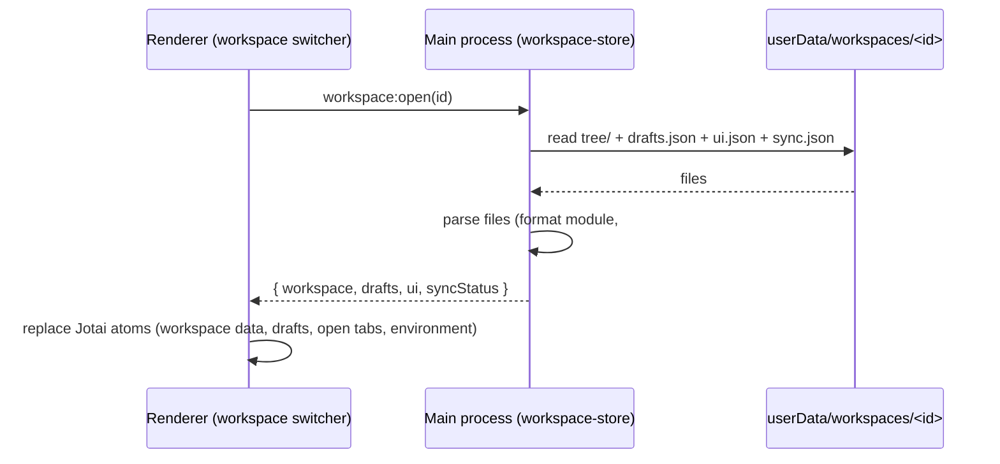
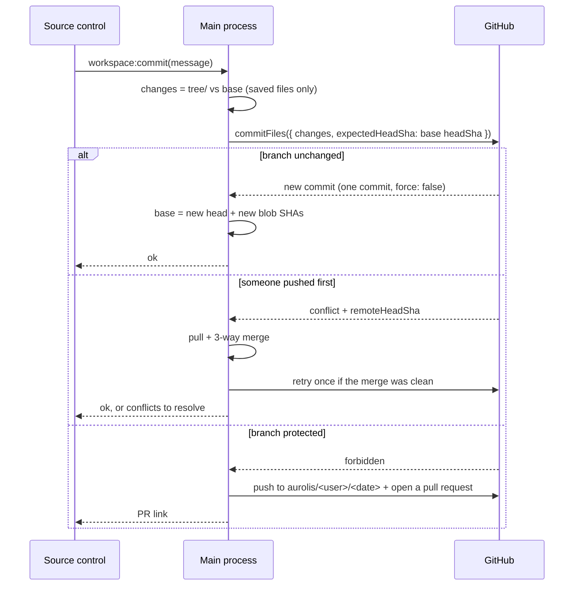

# Workspace architecture

**Status:** Accepted · **Issue:** #3 · **Builds on:** #1 (GitHub sign-in and sync API)

This document is the single reference for how Aurolis stores workspaces, links them to GitHub, switches between them and syncs them. Later issues implement parts of it; the [issue map](#issue-map) at the end shows which.

- [Summary](#summary)
- [Terms](#terms)
- [Workspace ↔ repo mapping](#workspace--repo-mapping)
- [On-disk layout](#on-disk-layout)
- [Synced vs not synced](#synced-vs-not-synced)
- [Secrets](#secrets)
- [Switching workspaces](#switching-workspaces)
- [Lifecycle flows](#lifecycle-flows)
- [Why no local `.git`](#why-no-local-git)
- [Security rules](#security-rules)
- [Limits](#limits)
- [Out of scope](#out-of-scope)
- [Issue map](#issue-map)

---

## Summary

- A **workspace** is one folder on the user's machine. Its `tree/` folder has exactly the layout of a GitHub repository (or a subfolder of one).
- A workspace is either **local-only** or **linked** to one `{owner, repo, branch, path}` on GitHub.
- All workspace data is read and written by the **Electron main process**. The renderer asks for data by workspace id over IPC and never sees file paths or tokens.
- Only `tree/` is ever synced. Drafts, UI state, history and secrets stay in `.aurolis/`, per user.
- Sync uses the GitHub REST API (`electron/github-sync.ts`), not a local git repository.

## Terms

| Term | Meaning |
|---|---|
| **Workspace** | A set of collections and environments, stored in one folder. The unit you switch between. |
| **Local workspace** | A workspace with no GitHub link. Works without signing in. |
| **Linked workspace** | A workspace connected to a GitHub `{owner, repo, branch, path}`. |
| **Remote** | The GitHub location a linked workspace syncs with. |
| **Working copy** | The saved files in `tree/`. What Ctrl/⌘ S writes to. |
| **Draft** | An unsaved edit. Lives in `.aurolis/drafts.json`, never in `tree/`, never synced. |
| **Base** | The state of the remote at the last successful pull or commit: a head commit SHA plus a blob SHA for every file. Changes are measured against it. |

## Workspace ↔ repo mapping

### The rules

1. **One workspace links to at most one remote:** `{ owner, repo, branch, path }`.
   - `path` is a folder inside the repo (`""` = the repo root). It lets one repo hold several workspaces, e.g. a monorepo with `workspaces/payments` and `workspaces/identity`.
2. **Different workspaces can link to different repos.** A user can have a personal workspace in `alex/api-playground` and a team workspace in `acme/payments-api` at the same time.
3. **One repo can back several workspaces** when the branch or the path differs, e.g. `acme/payments-api@main` and `acme/payments-api@release/2.0`.
4. **The same remote can't be linked twice.** The uniqueness key is `repoId + branch + path`. Opening an already-linked remote focuses the existing workspace instead of creating a copy.
5. **`repoId` (GitHub's numeric repository id) identifies the repo**, not `owner/repo`. If the repo is renamed or transferred, the link keeps working; the stored `owner` and `repo` are refreshed from GitHub on the next sync.
6. **A local workspace can be published** later, which turns it into a linked one. A linked workspace can be **unlinked**, which keeps the files and makes it local.

### Examples

| Workspace | Kind | Remote |
|---|---|---|
| My workspace | Local | — |
| Payments API | Linked | `acme/payments-api` · `main` · `/` |
| Payments API (2.0) | Linked | `acme/payments-api` · `release/2.0` · `/` |
| Identity | Linked | `acme/platform` · `main` · `workspaces/identity` |
| Playground | Linked | `alex/api-playground` · `main` · `/` |

### What gets committed

`tree/` mirrors the repo layout described in [github-integration.md › Repository structure](./github-integration.md#repository-structure): `aurolis.json` marks the folder as a workspace, every request is its own `*.req.json` file, and every environment is an `*.env.json` file. The exact file format and its schemas are owned by #4.

## On-disk layout

Everything lives under Electron's `userData` folder:

| OS | `userData` |
|---|---|
| macOS | `~/Library/Application Support/Aurolis` |
| Windows | `%APPDATA%\Aurolis` |
| Linux | `~/.config/Aurolis` |

```
<userData>/
├── github-token.bin                 ← GitHub session (electron/github-auth.ts), safeStorage-encrypted
├── workspaces.json                  ← registry of all workspaces + activeWorkspaceId
└── workspaces/<workspaceId>/
    ├── tree/                        ← exactly what's in the repo: aurolis.json, collections/, environments/
    └── .aurolis/                    ← per-user, never synced
        ├── sync.json                ← headSha, base { path → blob sha }, lastSyncedAt
        ├── objects/<sha>            ← base file contents (for diffs, 3-way merge, discard)
        ├── conflicts.json           ← unresolved merge conflicts after a pull
        ├── drafts.json              ← unsaved edits (Ctrl/⌘ S moves them into tree/)
        ├── ui.json                  ← open tabs, selected environment
        ├── history/  runs/          ← request history, load-test runs
        └── secrets.bin              ← environment secret values, safeStorage-encrypted
```

`workspaceId` is a random UUID created with the workspace. It never changes, even when the workspace is renamed or linked, so the folder name never needs to change either.

### `workspaces.json`

```json
{
  "version": 1,
  "activeWorkspaceId": "9b1c7c1e-…",
  "workspaces": [
    {
      "id": "9b1c7c1e-…",
      "name": "Payments API",
      "createdAt": "2026-11-24T10:00:00.000Z",
      "lastOpenedAt": "2026-11-24T12:30:00.000Z",
      "remote": {
        "repoId": 812345678,
        "owner": "acme",
        "repo": "payments-api",
        "branch": "main",
        "path": "",
        "permissions": { "push": true, "admin": false }
      }
    },
    {
      "id": "f02d…",
      "name": "My workspace",
      "createdAt": "2026-11-20T08:00:00.000Z",
      "lastOpenedAt": "2026-11-23T18:00:00.000Z",
      "remote": null
    }
  ]
}
```

- The folder is always `workspaces/<id>/`, so the registry doesn't store a path.
- `remote: null` means a local workspace.
- `permissions` is a cache of the user's role from `githubService.getRepositories()`, refreshed on open and on every sync (#16).

### `.aurolis/sync.json`

Only for linked workspaces. Written after every successful pull or commit.

```json
{
  "headSha": "4f1e…",
  "base": {
    "aurolis.json": "a3c9…",
    "collections/payments/_collection.json": "77d2…",
    "collections/payments/create-payment.req.json": "1b0e…"
  },
  "lastSyncedAt": "2026-11-24T12:31:05.000Z"
}
```

- `base` maps every synced file to its **Git blob SHA**. Aurolis computes the same SHA locally (`sha1("blob <size>\0" + content)`), so comparing a file in `tree/` to the base needs no network call.
- `headSha` is passed as `expectedHeadSha` when committing, so a push can never overwrite someone else's work (#14).
- `objects/<sha>` keeps the base content of each file, keyed by the same SHA. It's needed for request-level diffs, the 3-way merge (#13) and "discard change". Objects no longer referenced by `base` are deleted after each sync.

### Writing safely

- All writes go through the main process (`electron/workspace-store.ts`, #5).
- **Atomic writes:** write to `<file>.tmp`, then rename over the original, so a crash never leaves a half-written file.
- **One write queue per workspace**, so two saves never interleave.
- **Every path is resolved and checked to stay inside the workspace folder** before reading or writing.

## Synced vs not synced

| Data | Where | Synced to GitHub |
|---|---|---|
| Collections, folders, requests, examples | `tree/collections/…` | ✅ |
| Environments (non-secret values) | `tree/environments/*.env.json` | ✅ |
| Workspace marker | `tree/aurolis.json` | ✅ |
| Environment **secret values** | `.aurolis/secrets.bin` | ❌ never |
| Drafts (unsaved edits) | `.aurolis/drafts.json` | ❌ |
| Open tabs, selected environment | `.aurolis/ui.json` | ❌ |
| Request history, load-test runs | `.aurolis/history/`, `.aurolis/runs/` | ❌ |
| Sync state and base contents | `.aurolis/sync.json`, `.aurolis/objects/` | ❌ |
| GitHub session | `<userData>/github-token.bin` | ❌ |

Only **saved** files are committed. A draft has to be saved with Ctrl/⌘ S before it can appear in a commit.

## Secrets

- A variable marked **secret** is written to its `*.env.json` file with the key and an **empty value**:
  ```json
  { "key": "apiKey", "value": "", "secret": true }
  ```
- The real value is stored in `.aurolis/secrets.bin`, keyed by `environmentId` + variable key, encrypted with Electron `safeStorage` (macOS Keychain, Windows DPAPI, libsecret/KWallet on Linux).
- Values are merged in only when a request is sent, in the main process.
- If the OS has no real keychain (Linux `basic_text` backend), secrets are kept **in memory only** for the session and the app shows a warning. They are never written in plain text.
- Teammates each enter their own secret values. Sharing secrets through the repo is out of scope (see [Out of scope](#out-of-scope)).

## Switching workspaces

Switching must be instant and must never lose work, so nothing has to be "closed" first.



- **Drafts and UI state are per workspace and already on disk** (written with a debounce while you edit). Switching just loads another set, so there is no "unsaved changes" prompt.
- The renderer keeps **one workspace in memory**: the active one. Others are only listed from the registry.
- Requests in flight keep running and their results are stored in the history of the workspace they were sent from.
- The background sync check (#17) only polls the active linked workspace.
- On launch, Aurolis opens `activeWorkspaceId`. If the registry is empty, it creates a local "My workspace".

## Lifecycle flows

### Create a local workspace (#5, #6)
Create `workspaces/<id>/tree/aurolis.json` and an empty `.aurolis/`, add the entry to the registry with `remote: null`, and open it.

### Save (#8)
Ctrl/⌘ S serializes the item (#4), writes only the files that changed into `tree/`, and removes the item from `drafts.json`. Nothing touches GitHub.

### Detect changes (#10)
Compute the blob SHA of each file in `tree/` (cached by modified time) and compare it to `sync.json` `base`. A file is **A**dded, **M**odified or **D**eleted. The format module maps paths back to API items, so a renamed request shows as one moved request.

### Open a workspace from GitHub (#11)
Pick the repo, branch and optional path. If that remote is already linked, open that workspace. Otherwise `pullFiles` into a new `tree/`, write `sync.json` and `objects/`, and add the registry entry. If `aurolis.json` is missing, offer to initialize the folder as a workspace.

### Publish a local workspace (#12)
Commit every file in `tree/` to an empty repo, or to a new subfolder of an existing repo, with `commitFiles`. Then write the base snapshot and set `remote`.

### Pull (#13)
`pullFiles` with `knownFiles = base` downloads only files that changed on GitHub. For each one:
- **unchanged locally** → take theirs;
- **changed on both sides** → 3-way merge per field (method, URL, headers by key, body, auth, examples), using `objects/` as the common base;
- **real clash** → write to `conflicts.json` and ask "Keep mine / Take theirs" per field.

`sync.json` is updated only once every conflict is resolved.

### Commit & push (#14)



### Discard a change (#15)
Write the base content from `objects/<sha>` back into `tree/` (or delete the file if it was added).

### Delete a workspace (#5)
Remove `workspaces/<id>/` and the registry entry. For a linked workspace with uncommitted changes, warn first. Nothing on GitHub is deleted.

### Sign out (#7)
The GitHub session is deleted. All workspaces stay. Linked workspaces open normally, and their sync actions are disabled until the user signs in again.

## Why no local `.git`

| Option | For | Against |
|---|---|---|
| **GitHub REST API** (chosen) | No git binary to ship or detect. Uses the device-flow GitHub App token directly. One atomic commit per sync through the Git Data API, moved with `force: false`. Reads only the files that changed. Already built and tested in #1. | No offline commit history. Needs the network to commit. Bounded by API limits (see [Limits](#limits)). |
| System `git` | Full git features, offline history. | Users may not have git. Credential setup clashes with the device-flow token. Users could edit the repo outside Aurolis in ways it can't merge. |
| `isomorphic-git` | Pure JS, no binary. | Large dependency. Needs a CORS proxy or main-process transport. Full clones are slow for big repos. Same credential problem. |

The workspace folder still matches the repo layout, so a developer can clone the repo with normal git at any time and see exactly the same files.

## Security rules

- Workspace files, secrets and tokens are only touched in the **main process**.
- IPC takes **workspace ids**, never file paths. Every resolved path must stay inside `workspaces/<id>/`.
- Renderer input is validated in the main process (names, ids, paths, sizes), following the IPC rules in `CLAUDE.md`.
- GitHub calls only go to `api.github.com`, through `githubApi` (`electron/github-api.ts`).
- Secret values are never written to `tree/`, never logged and never sent to GitHub.

## Limits

These come from the GitHub API and the choices above. They are enforced in `electron/github-sync.ts`.

| Limit | Value | What happens |
|---|---|---|
| File size | 5 MB per file | Pull or commit fails with `too_large`. |
| Files per commit | 1,000 changes | Commit fails with `invalid_input`. |
| Repo listing | GitHub truncates very large trees (about 100,000 entries) | Pull fails with `too_large`. Use a subfolder `path`. |
| Rate limit | About 5,000 requests per hour per user | `rate_limited` with `resetAt`. Background checks use ETags, so unchanged polls are free (#17). |

## Out of scope

Recorded here so they aren't reopened by accident:

- **Choosing a custom folder** for a workspace (e.g. inside an existing git clone).
- **Sharing secrets through the repo** (encrypted with sops/age, or vault references).
- **More than one GitHub account** signed in at the same time.
- **Real-time collaboration** (live cursors, presence).
- **Self-hosted Git providers** (GitLab, Bitbucket, GitHub Enterprise Server).

## Issue map

| Section | Issue |
|---|---|
| Foundations | #2 |
| This document | #3 |
| File format in `tree/` | #4 |
| [On-disk layout](#on-disk-layout), registry, safe writes | #5 |
| [Switching workspaces](#switching-workspaces) | #6 |
| Local mode, [sign out](#sign-out-7) | #7 |
| [Save](#save-8), drafts | #8 |
| [Secrets](#secrets) | #9 |
| [Detect changes](#detect-changes-10), `sync.json`, `objects/` | #10 |
| [Open from GitHub](#open-a-workspace-from-github-11), [mapping rules](#workspace--repo-mapping) | #11 |
| [Publish](#publish-a-local-workspace-12) | #12 |
| [Pull](#pull-13) | #13 |
| [Commit & push](#commit--push-14) | #14 |
| Source control screen, [discard](#discard-a-change-15) | #15 |
| Permissions (`remote.permissions`) | #16 |
| Background sync, [limits](#limits) | #17 |
